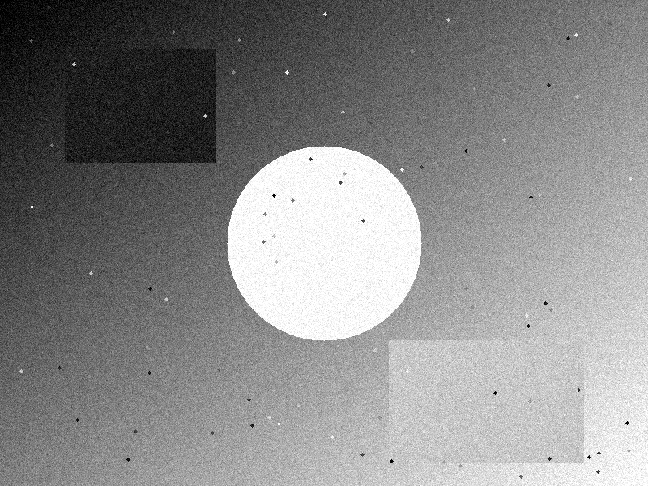
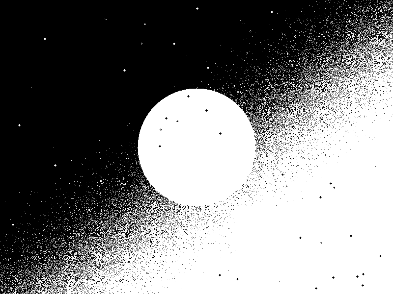
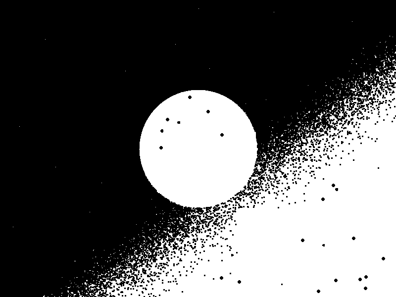
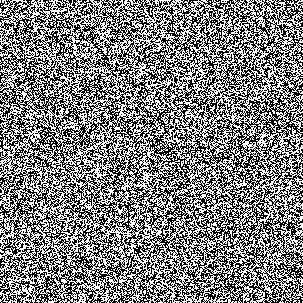
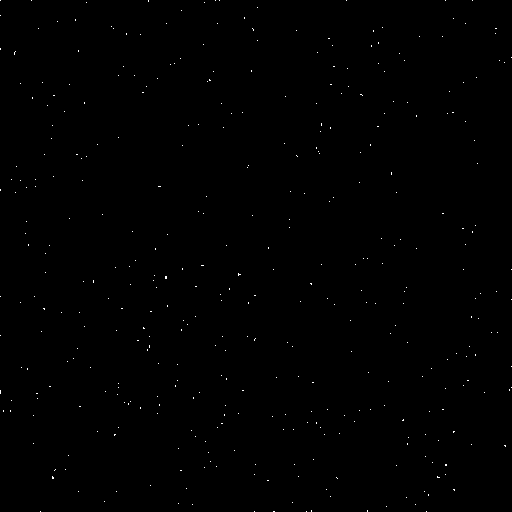
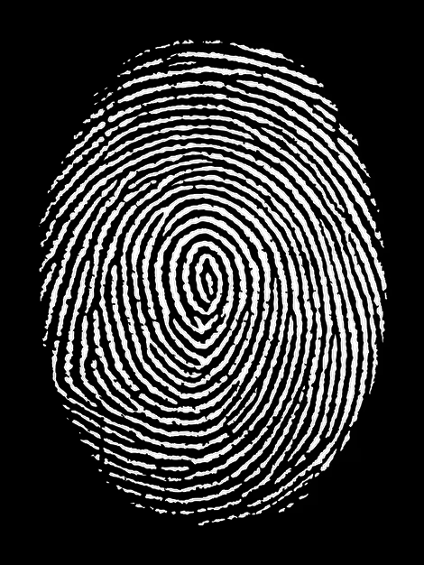
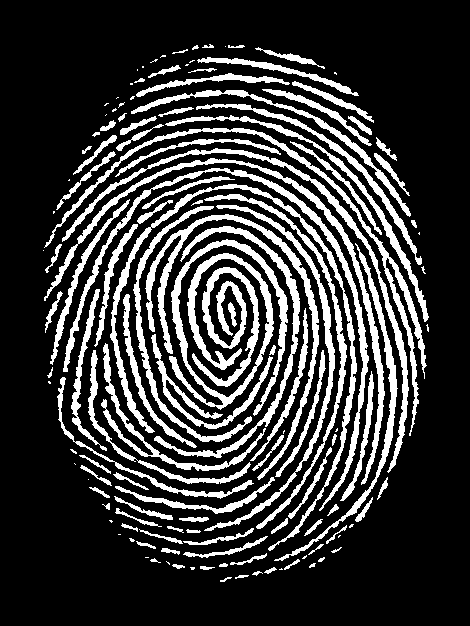
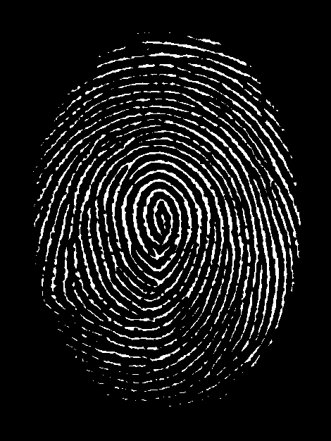
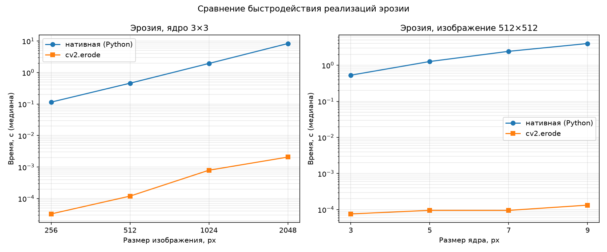

# ЛР1 — Эрозия (вариант 7)

**Предмет:** Системы компьютерной обработки изображения
**Вариант:** 7 — Эрозия, примитив размера 3×3
**Язык реализации:** Python 3.15

Задание — см. [task.md](task.md).

## Запуск

```bash
py -m pip install -r requirements.txt

# сгенерировать тестовые изображения (однократно)
py src/generate_images.py

# обработать изображение: бинаризация Отсу + эрозия двумя способами + тайминги
py src/main.py images/sample_shapes.png

# замер быстродействия (график + CSV)
py src/benchmark.py
```

## 1. Теоретическая база

**Эрозия** — одна из двух базовых операций математической морфологии
(вторая — дилатация). Название говорит само за себя: белые объекты на
изображении «разъедаются» с краёв.

У операции есть **структурный элемент** — маленький шаблон, который как бы
прокатывается по всему изображению. В этой работе это квадрат 3×3 из
единиц.

Алгоритм простой: для каждого пикселя изображения берём окно 3×3 с центром
в нём и:

- для **бинарного** изображения (только чёрное и белое) — результат будет
  белым, только если **все** 9 пикселей окна белые; если в окне есть хоть
  один чёрный — результат чёрный. Эрозия здесь по сути — логическое «И»
  по окну;
- для **полутонового** — берём **минимум** из 9 значений.

Что это даёт на практике: любые детали меньше структурного элемента
(тонкие линии, мелкие точки, шум) исчезают полностью, а крупные объекты
слегка сжимаются. Поэтому эрозию применяют для удаления шума, отделения
слипшихся объектов, утончения форм.

**Границы изображения.** У пикселей возле края окно выходит за пределы
картинки. Такие «виртуальные» пиксели считаем белыми, то есть просто не
учитываем их. `cv2.erode` по умолчанию делает то же самое, поэтому обе
реализации дают одинаковый результат.

**Бинаризация.** По условию задания её можно не реализовывать вручную,
поэтому используется готовая `cv2.threshold` с автоматическим порогом по
**методу Отсу**.

По сложности: наивная реализация делает 9 сравнений на каждый пиксель,
то есть `O(W·H·|B|)`, где `|B|` — площадь структурного элемента. Этим и
объясняется разница во времени с библиотечной реализацией, которую видно
в экспериментах ниже.

## 2. Описание разработанной системы

### Архитектура

```
lab_1/
├── task.md              # задание
├── requirements.txt     # зависимости (opencv-python, numpy, matplotlib)
├── src/
│   ├── binarize.py      # бинаризация: cv2.threshold + метод Отсу
│   ├── erosion_native.py# нативная эрозия (циклы на Python)
│   ├── erosion_cv2.py   # библиотечная эрозия (cv2.erode)
│   ├── generate_images.py # генерация тестовых изображений
│   ├── main.py          # CLI: обработка изображения + тайминги
│   └── benchmark.py     # эксперименты по быстродействию + график
├── images/              # тестовые изображения
└── results/             # результаты: картинки, benchmark.csv, benchmark.png
```

Обе реализации эрозии имеют одинаковый интерфейс
`erode(image, kernel=None) -> image`, где `kernel` — структурный элемент
(по умолчанию 3×3 из единиц). Благодаря этому `main.py` и `benchmark.py`
вызывают их идентично, а корректность проверяется прямой проверкой
`np.array_equal`.

### Алгоритмы

**Нативная эрозия** (`erosion_native.erode_native`):

1. Предвычислить список смещений активных точек СЭ относительно центра.
2. Для каждого пикселя `(y, x)` пройти по смещениям, игнорируя выходы за
   границы изображения.
3. Взять минимум значений по окну и записать в результат.

Внутренний цикл — чистый Python (доступ к данным через `tolist()` для
быстрого чтения скаляров); никакие библиотечные функции морфологии не
используются.

**Библиотечная эрозия** (`erosion_cv2.erode_cv2`) — вызов
`cv2.erode(image, kernel)`.

**Конвейер** (`main.py`): загрузка grayscale → бинаризация Отсу → эрозия
двумя способами → контроль совпадения (`np.array_equal`) → сохранение
результатов (`*_binary.png`, `*_eroded_native.png`, `*_eroded_cv2.png`,
`*_diff.png` — карта расхождений) и вывод таймингов.

**Эксперименты** (`benchmark.py`): время как функция размера изображения
(256²…2048², ядро 3×3) и как функция размера ядра (3×3…9×9 при
512×512); для каждой точки — несколько прогонов, берётся медиана
(`time.perf_counter`).

## 3. Результаты работы и тестирования

### Визуальная демонстрация

Синтетическая сцена (градиент + фигуры + мелкие точки + шум), бинаризация
методом Отсу и эрозия 3×3:

| Этап | Результат |
|---|---|
| Исходное изображение |  |
| После бинаризации Отсу |  |
| Эрозия (нативно) |  |
| Эрозия (cv2.erode) |  |
| Карта расхождений |  |

Результаты обеих реализаций совпадают попиксельно (`np.array_equal == True`),
карта расхождений полностью белая — расхождений нет. Виден характерный
эффект эрозии: мелкие точки и шум исчезли, крупные объекты сжались.

Равномерный шум после бинаризации Отсу: эрозия 3×3 практически полностью
убирает «зерно»:

| После бинаризации | После эрозии (cv2) |
|---|---|
|  |  |

### Демонстрация на реальном изображении: отпечаток пальца

Реальный скан отпечатка (`images/finger.png`, 470×626): белый узор на тёмном
фоне — правильная полярность для морфологии («объект» кодируется белым),
поэтому после бинаризации Отсу эрозия применяется к линиям-гребням в
классической постановке.

| Этап | Результат |
|---|---|
| Исходное изображение |  |
| После бинаризации Отсу |  |
| Эрозия (нативно) |  |
| Эрозия (cv2.erode) |  |
| Карта расхождений |  |

Обе реализации снова дали попиксельно идентичный результат (нативная
0.45 с, cv2 0.0003 с, ускорение ~1400×). Замеры по бинарным картинкам:
доля белых пикселей упала с 21.7% до 9.5% — гребни узора утоньшились,
мелкие светлые пятна исчезли. Число связных областей выросло
с 139 до 497: часть пятен пропала, а тонкие участки гребней разорвались,
разделив узор на отдельные сегменты. Практический вывод: ядро 3×3
заметно меняет тонкие структуры, поэтому его размер подбирают под
толщину объектов (для бережного утоньшения линий отпечатка используют
пару «эрозия + дилатация» — операцию открытия).

### Быстродействие

Эксперимент 1 — зависимость от размера изображения (ядро 3×3):

| Размер | Нативная, с | cv2.erode, с | Ускорение |
|---|---|---|---|
| 256×256 | 0.0965 | 0.000028 | ×3408 |
| 512×512 | 0.4201 | 0.000111 | ×3799 |
| 1024×1024 | 1.6219 | 0.000609 | ×2663 |
| 2048×2048 | 7.3222 | 0.001703 | ×4300 |

Эксперимент 2 — зависимость от размера ядра (изображение 512×512):

| Ядро | Нативная, с | cv2.erode, с | Ускорение |
|---|---|---|---|
| 3×3 | 0.4074 | 0.000063 | ×6498 |
| 5×5 | 1.0464 | 0.000120 | ×8742 |
| 7×7 | 2.0536 | 0.000088 | ×23284 |
| 9×9 | 3.3785 | 0.000159 | ×21182 |



Закономерности:

- время нативной реализации растёт **линейно по числу пикселей**:
  рост размера 256²→2048² (×64 пикселей) увеличил время
  0.0965→7.32 с (×76);
- время нативной реализации растёт **линейно по площади ядра**:
  3×3→9×9 (площадь ×9) увеличили время 0.407→3.378 с (×8.3) —
  согласуется со сложностью `O(W·H·|B|)`;
- `cv2.erode` быстрее на **2–4 порядка** (тысячи раз) во всех точках.

Конфигурация: Windows, Python 3.15.1, numpy 2.5.4, OpenCV 5.0.0.
Полные данные — [results/benchmark.csv](results/benchmark.csv).

## 4. Выводы по работе

1. Реализована операция эрозии двумя способами: нативно на Python и через
   встроенную функцию `cv2.erode` библиотеки OpenCV. Обе реализации дают
   попиксельно идентичный результат, что подтверждено автоматической
   проверкой `np.array_equal` на всех тестовых изображениях.
2. Нативная реализация на 2–4 порядка медленнее библиотечной
   (ускорение ~2600–23000 раз): интерпретируемые циклы CPython с
   попиксельными проверками границ против оптимизированной C-реализации
   OpenCV (SIMD-векторизация и специальные алгоритмы для прямоугольных СЭ,
   не зависящие от размера ядра).
3. Экспериментально подтверждена теоретическая сложность наивной эрозии:
   время линейно по числу пикселей и по площади структурного элемента.
4. Морфологическая эрозия эффективно удаляет мелкий шум и детали,
   меньшие структурного элемента, что видно на синтетической сцене и
   на шумовом изображении.

## 5. Использованные источники

1. OpenCV documentation — Eroding and Dilating / cv::erode:
   https://docs.opencv.org/master/db/df6/d7e8_erode_8cpp-example.html
2. OpenCV documentation — cv::threshold:
   https://docs.opencv.org/master/d7/d1b/tutorial_py_thresholding.html
3. Gonzalez R. C., Woods R. E. Digital Image Processing (4th ed.) — гл. 9
   «Morphological Image Processing».
4. Soille P. Morphological Image Analysis: Principles and Applications.
   Springer, 2003.
5. van Herk M. A fast algorithm for local minimum and maximum filters operating
   on rectangular and octagonal kernels. Pattern Recognition Letters, 1992.

